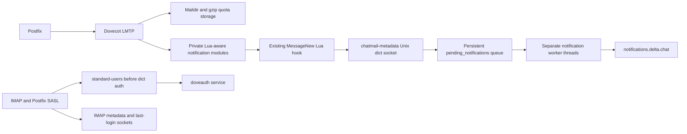

# DeltaChat runtime upgrade assessment — November 15, 2026

This document records read-only production evidence and the local candidate
design. No production package/configuration, mailbox or service was changed, and
no real notification or message was sent. Runtime test results live in the
specific build's artifacts; a proposed test is not a passing result.

## Verified baseline

`delta` is the established SSH alias for root at `5.78.82.34`, hostname
`chat.active-iq.com`. It runs AlmaLinux 10.2, kernel
`6.12.0-211.74.1.el10_2.x86_64`. This is separate from the ANSRLabs Mailcow host.

Core and Pigeonhole are signed Alma packages
`1:2.3.21-16.el10_1.1.x86_64`, with versionlocks from May 13 and May 28.
The custom unsigned addon is labelled `2.3.21-19.el10_2.1.el10`; its dependency
allows any core version at least 2.3.21. That label does not prove the actual
binary ABI. The addon verifies against its installed RPM, but its scriptlet
copies a Lua-aware library over Alma's `lib20_push_notification_plugin.so`.
The two files have the same SHA-256:
`47f6ffb0591c6106959302cd98869249411156200cb74e2105c7515ac10a3be5`.
The live hook hash is
`fc8ba06f7ebd5e212663af7a57b5bab76c9aea1abb863a4e52cad4c081d71f40`.

The installed core changelog already records fixes for CVE-2026-27858,
CVE-2026-27857 and CVE-2025-59032. Available advisory metadata therefore must not
be interpreted as proof that every listed fix is missing. The current Alma
candidate is `2.3.21-19.el10_2.8`, including the October 9 security update
[ALSA-2026:79371](https://errata.almalinux.org/10/ALSA-2026-79371.html).
This is an intermediate vendor update, not proof of complete upstream security
parity. The August 2026 upstream disclosure lists 25 CVEs; the Alma source spec
explicitly maps a subset. The maintained relay runtime matrix must classify the
remaining source/binary/configuration applicability before a parity claim or
promotion. Some issues affect ordinary IMAP LIST, THREAD or compression paths.

The legacy updater failed with exit 1 on November 15, 03:33–04:03 UTC. Its unit
journal returned no entries, so the precise failure cause remains unproved.
The missing matching release and 30-minute duration suggest its polling timeout;
that is an inference. The timer remains active, next November 22 at 03:34 UTC.
It runs separate core upgrade, `rpm --nodeps` addon installation and restart
steps. It is neither atomic nor a safe consumer of this new package layout.

File birth times place updater, service, timer, core versionlock and the May 13
automation commit within the same minute. This supports a coordinated deployment
history, but does not establish the lock's author or exact reason.

## Ownership and data flow

The deployed Python distribution is chatmaild 0.2 under
`/usr/local/lib/chatmaild/venv`. The hook opens/syncs the delivered mailbox and
sets `/private/messagenew` when the sender differs from the recipient.
`chatmail-metadata` reads each mailbox's `metadata.json` device-token list,
persists pending notifications and queues separate worker threads. HTTP 200
completes an item; 410 also removes the invalid device token. Failures retry on
an exponential schedule with a five-hour deadline. These services and data
remain owned by the chatmail runtime; the addon does not replace them.

The existing runtime preserves TLS 1.3 minimum, 1000M quota, 31,457,280-byte
maximum message size, gzip writes, IMAP compression, special-use folders,
last-login tracking, and standard-user authentication precedence. Other active
workloads include LiveKit, RustDesk, Pangolin, iroh and GCS archive services.

Build ownership is `target.env` → verified Alma SRPM/security patches → explicit
Lua compatibility patch → one installed module tree → exact-core addon RPM.
The reviewed sample changes only LMTP's module directory; it is never enabled
by package scriptlets. The real runtime fixture is the gate for module loading.

## Why the immediate candidate remains on the Alma 2.3 branch

The latest upstream Dovecot CE is
[2.4.5](https://github.com/dovecot/core/releases/tag/2.4.5). The latest released
[chatmail relay 1.13.0](https://github.com/chatmail/relay/releases/tag/1.13.0)
includes chatmaild 0.3 and newer Lua/HTTP authentication, but its
[runtime pins](https://github.com/chatmail/relay/blob/1.13.0/cmdeploy/src/cmdeploy/pins.py)
still select a custom Debian Dovecot 2.3 build. That is not an endorsed Alma 2.4
runtime set. This addon cannot safely substitute for an application migration.

The [official 2.3-to-2.4 guide](https://doc.dovecot.org/2.4.4/installation/upgrade/2.3-to-2.4.html)
removes the dictionary authentication backends used by the live configuration.
A 2.4 candidate must replace that contract, convert configuration and variable
syntax, migrate compression/metadata settings, rebuild all native modules and
verify storage/recovery. Its small Lua hook appears portable in intent, but this
repository does not claim to have validated it on 2.4.5.

The owning downstream chatmail runtime/fork and its upstream changes must be
reviewed separately. Do not replace chatmaild 0.2 with 0.3 merely by changing this
addon's pin; provisioning, password files, metadata, filters and retention are
application interfaces.

## Production rollout prerequisites and sequence

1. Finish candidate build/unit/runtime tests and review the exact diff and
   artifact hashes. Sign the addon through the established secret/key custody
   path. Do not publish a production-consumable `dovecot-*` release.
2. Establish exact recovery material: signed installed core/Pigeonhole RPMs,
   current custom modules and configuration, relevant chatmail services and
   persistent metadata/notification state. Existing saved `-16.el10` RPMs differ
   from installed `-16.el10_1.1`; December 2025 backups are not a current restore
   point. Archive availability alone does not establish restore acceptance.
3. Rehearse both upgrade and restoration in an isolated mail-state copy using
   synthetic accounts. Verify package and config readback, UID/UIDVALIDITY,
   message hashes, metadata, gzip reads, quota and auth semantics. No two servers
   may write the same mail tree.
4. Review the specific live change with the operational architect. Agree the
   mail maintenance window and avoid archive/offload jobs. Capture timer and
   versionlock state, then suspend the old consumer under the approved rollout.
   This document does not authorize stopping it during assessment/build work.
5. Stop only affected mail delivery components in an ordered, bounded sequence
   that preserves queued mail. Migrate the historical addon and restore Alma's
   stock library from the matching signed core RPM; do not rely on the stale
   one-time `.distro` backup or old package uninstall scriptlet. Apply the exact
   core/Pigeonhole/addon set and the reviewed LMTP fragment. Simulate the final
   package transaction beforehand; never use `--nodeps`.
6. Read back package identity, module hashes, config, sockets and ownership;
   resume mail, then exercise separately authorized account/device acceptance.
   Re-enable only a reviewed maintenance mechanism after qualification. Preserve
   unrelated services and their running state throughout.

## Validation and recovery boundaries

The isolated suite checks real LMTP delivery through the rebuilt Lua modules,
metadata handoff, self-message suppression, concurrent user isolation, gzip
readability and a failed/recovered backend. It also checks stock library hashes
across addon installation/removal. It uses a faithful local dict-protocol mock,
not real device tokens or an external push service. Unit tests cover rejected
pins, source layout, duplicate artifacts and build RPATHs. Upstream's complete
Dovecot test suite is not run by the source RPM compile step (`--nocheck`).

Real account auth, phone wakeup, full archive compatibility and a production
rollback rehearsal remain distinct gates. A service marked active proves none
of these. Before the candidate accepts writes, recovery can restore the exact
prior mail package/module/config set. After writes, retain and reconcile newly
accepted mail, indexes, metadata and pending notifications; package downgrade
alone is not proven recovery. Whole-host snapshot restoration would also rewind
unrelated workloads and therefore requires a separate coordinated boundary.

Failures remain in the build's ledger/status/provenance and synthetic test
receipts. Unknown runtime behavior blocks promotion. No source change adds a
generative choice; existing notification retry behavior is left intact.
